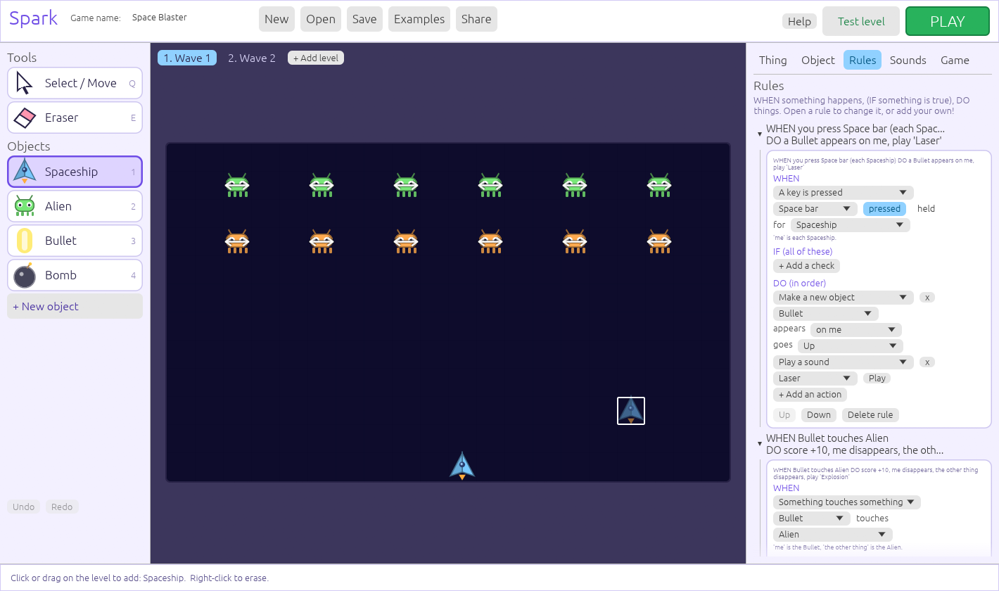
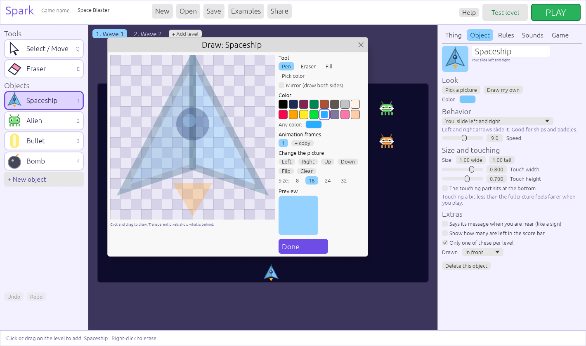

# Spark: make your own video game!

Spark is a game maker written in pure Rust. You do not need to write code: click to build a level,
draw your own pictures, make sounds, set up rules, and press **PLAY**. When you are ready, you can
also make games with a few lines of Rust.



## Get the finished program (Windows)

Run this once in the project folder:

```
powershell -ExecutionPolicy Bypass -File package.ps1
```

It builds the optimized program and makes:

* `dist\Spark\Spark.exe`: double-click to open the game maker. It has its own icon, needs no installer and no
  extra software, and has the example games in the `games` folder next to it.
* `dist\Spark-windows.zip`: the same folder zipped, to give to friends.

Keep the folder somewhere you can save files (Desktop, Documents), not in "Program Files".

## Start it from the code

1. Install Rust from <https://rustup.rs>
2. In this folder, run:

```
cargo run --release
```

(The first time takes a few minutes. After that it opens right away.)

## Make ANY kind of game

Spark does not have a "game type" switch. Instead, every game is built from the same three ideas,
and you can mix them any way you like:

* **Objects** have a **look** (a built-in picture or your own pixel art) and a **behavior** (how it moves).
* **Rules** say what happens: **WHEN** something happens, **IF** something is true, **DO** things.
* **Levels** are grids where you place objects.

Open **Examples** to play and take apart one game of each kind:

| Example | Kind of game | What makes it work |
|---|---|---|
| Sky Run | Jumping game | Hero that "runs and jumps", springs, enemies you squash by landing on them |
| Maze Garden | Top-down maze | Explorer that "walks in 4 directions", a ghost that follows you |
| Space Blaster | Shooting game | Spaceship, Space key spawns a bullet, bullets destroy aliens, aliens drop bombs |
| Brick Breaker | Ball and paddle | A ball that "bounces like a ball", a paddle, a rule that says Bounce |
| Star Catcher | Catching game | A timer rule makes stars fall from the sky, you catch them in a basket |
| Crate Pusher | Puzzle | A player that hops one square at a time and pushes crates onto targets |

## Make a game in 3 steps

1. **Pick** an object on the left (or press **+ New object** and choose one, like Alien or Ball).
2. **Click or drag** on the level to place it. **Right-click** to erase.
3. Press the green **PLAY** button.

| While making | |
|---|---|
| `Q` / `E` | Select-and-move tool / Eraser |
| `1`..`9` | Pick the first nine objects |
| `Ctrl+Z` / `Ctrl+Y` | Undo / Redo |
| `Ctrl+S` | Save |
| `Delete` | Remove the selected thing |

| While playing | |
|---|---|
| Arrow keys or `W A S D` | Move |
| `Space` or Up | Jump (in jumping games) |
| `Space`, `Z`, `X`, `Enter` | Can be used by your rules, for example to shoot |
| `R` | Play again (after winning or losing) |
| `Esc` | Stop |

## The tabs on the right

### Thing
Select something in the level to change its color, how it moves, its speed, or its message.

### Object: look and behavior
Every kind of object has its own settings:

* **Look**: *Pick a picture* (23 built-in ones) or *Draw my own* (see below).
* **Behavior**: how it moves.

| Behavior | What it does |
|---|---|
| Just sits there | Coins, flags, decorations |
| Solid block | Things that move can't pass it (walls, doors) |
| You: run and jump | Arrow keys run, Space jumps, gravity pulls |
| You: walk in 4 directions | Top-down games |
| You: slide left and right / up and down | Ships and paddles |
| You: hop one square at a time | Puzzles. Pushes crates! |
| Walks left and right / moves up and down | Patrolling enemies |
| Wanders around | Random movement |
| Follows you (ghost) | Floats towards you through walls |
| Falls with gravity | Falling rocks |
| Flies in a straight line | Bullets, bombs, falling stars |
| Bounces like a ball | Bounces off walls and edges |
| Crate (can be pushed) | Pushed by the hopper |

* **Size and touching**: how big it is (a paddle can be 3 squares wide) and which part touches things.
* **Extras**: talk like a sign, show "how many are left", only one per level, drawn in front or behind.

### Rules: WHEN, IF, DO
Open a rule to change it. A rule is made of three parts.

**WHEN** (what starts it): the level starts · every few seconds · a key is pressed · something touches
(or stops touching) something · none of something are left · some seconds after the level starts ·
the score reaches a number · a counter reaches a number · something jumps · something leaves the level.

**IF** (optional checks, all must be true): it lands on top (a stomp) · none / some of something are left ·
the score or a counter is at least a number · only some of the time (a percent chance).

**DO** (in order): change the score, lives or a counter · lose a life · finish the level · restart the level ·
game over · win the game · make something disappear (me, the other thing, or every one of a type) ·
**make a new object appear** (on me, at the top, anywhere, flying up, down, towards the player...) ·
send the players back to the start · jump up high · bounce off the other thing · play a sound · say something.

"Me" is the first thing in the WHEN, and "the other thing" is the second. For example, in
*WHEN a Bullet touches an Alien*, me is the Bullet and the other thing is the Alien.

**Recipes**

* *Shooting:* WHEN you press Space bar (each Spaceship) DO a Bullet appears on me, flying up.
* *Collecting:* WHEN Player touches Coin DO score +10, the other thing disappears.
* *A key that opens a door:* a counter called Keys. WHEN Player touches Key DO Keys +1, the other thing
  disappears. WHEN Player touches Door IF Keys is at least 1 DO the other thing disappears.
* *Win when everything is gone:* WHEN none of Alien are left DO finish the level.
* *Things that fall from the sky:* WHEN every 0.7 seconds DO a Falling star appears along the top.
* *Lose a life when the ball falls out:* WHEN Ball leaves the level DO lose a life, a Ball appears where I started.

### Sounds
Sounds are made from numbers, so there are no sound files. Pick a ready-made one (Coin, Jump, Laser,
Explosion...), change the pitch, slide, length and wobble, press **Hear it**, or press **Surprise me!**
for a random variation. Use them in rules with the *Play a sound* action. Pick a **music** tune
(Happy, Adventure, Spooky, Chill, Action!) and set the volumes.

### Game
Lives, the win message, **counters** (like Keys or Ammo) and the settings for the level you are looking at.

## Draw your own pictures



In the **Object** tab press **Draw my own**. You get a pen, eraser, fill bucket, color picker, a 16-color
palette (and any color you like), mirror drawing, and sizes from 8 to 32 pixels. The picture it has now
shows faintly behind the grid so you can trace over it. The object keeps its old picture until you draw
the first pixel.

**Use a picture you already have.** Press **Import PNG...** (in the Object tab or in the drawer), or just
**drag a PNG file onto the Spark window**. Pictures bigger than 32 pixels are shrunk to fit, small
pixel art is kept exactly, and see-through parts stay see-through. In the drawer, **Add as a frame**
adds the PNG as another animation frame, and you can keep drawing on top of anything you import.

Make it move: **+ copy** adds an animation frame, and the speed slider plays them in a loop.
Your picture automatically faces left or right when the object does.

## Save, open and share

* **Save** keeps your game in the `games` folder (closing the window saves too, so nothing is lost).
* **Open** shows your saved games. **Examples** has finished games.
* **Share** makes a folder in `exports` with a copy of Spark that opens straight into your game. Give that folder to a friend!
* Games saved by older versions of Spark open automatically.

## Make a game with Rust code

Levels can be drawn with letters:

```rust
use spark::prelude::*;

fn main() {
    Game::new("My First Game")
        .lives(3)
        .level("Level 1", &[
            "........................",
            ".........C.C.C.......G..",
            "......#######.......###.",
            ".P..........E.....^^....",
            "########################",
        ])
        .play();
}
```

`#` wall, `P` player, `C` coin, `G` goal, `^` spikes, `S` spring, `E` enemy (left-right),
`U` enemy (up-down), `H` ghost, `?` sign, `.` empty.

Add your own objects and give them a letter, and add rules in code:

```rust
let mut game = Game::new("Stars");
let star = game.add_template("Star").unwrap();           // any object from the "+ New object" list
let game = game
    .rule(Rule::new(
        Trigger::Touch { a: PLAYER, b: star },
        &[Action::AddScore(50), Action::Destroy(Target::Other), Action::PlaySound(sounds::POWERUP)],
    ))
    .level_with("One", &[".P....*.", "########"], &[('*', star)]);
game.play();
```

Run the bigger ones with `cargo run --example code_game` and `cargo run --example code_shooter`
(a whole shooting game from three rules). Use `.edit()` instead of `.play()` to open a game in the editor.

## Other commands

```
spark examples        save the example games into the games folder
spark play FILE       play a .spark game
spark FILE            open a .spark game in the editor
```

## How it is built (for curious grown-ups)

| File | What it does |
|---|---|
| `src/data.rs` | Object types, behaviors, levels, rules, counters. Saved as readable JSON `.spark` files. |
| `src/legacy.rs` | Opens games saved by the first version of Spark. |
| `src/engine.rs` | Movement, collisions, behaviors, spawning, and the WHEN / IF / DO rules. No window needed. |
| `src/sound.rs` | Sound effects and music made from waves. No sound files. |
| `src/audio.rs` | Plays them through the speakers (using `rodio`). The game works without a sound device. |
| `src/render.rs` | Draws the built-in pictures from shapes, and your pixel art as textures. |
| `src/editor/` | The visual editor: `mod.rs` (main screen), `object.rs`, `rules.rs`, `sounds.rs`, `sprite.rs` (picture drawer and PNG import). |
| `src/play.rs` | The stand-alone player window. |
| `src/examples.rs` | The built-in example games. |

Because the engine has no window, it is tested directly: `cargo test` runs about 60 tests, including
little "bots" that play the shooter, the ball game and the catching game, a scripted solution for the
puzzle, and a test that mashes random buttons on every example. The editor is tested by drawing every
screen with no window and checking the layout.

The dependencies that do real work are [egui/eframe](https://github.com/emilk/egui) (window and
buttons), [rodio](https://github.com/RustAudio/rodio) (speakers), [image](https://github.com/image-rs/image)
(PNG pictures) and [rfd](https://github.com/PolyMeilex/rfd) (the file window). All are Rust.

### Developer hooks

Environment variables for taking pictures of the editor: `SPARK_SCREENSHOT=out.png` saves a picture
of the window and quits; `SPARK_TAB=rules|object|sounds|game`, `SPARK_OPEN_RULES=1`, `SPARK_SPRITE=1`
and `SPARK_PLAY=1` choose what is on screen. The pictures in `docs/` were made this way.
